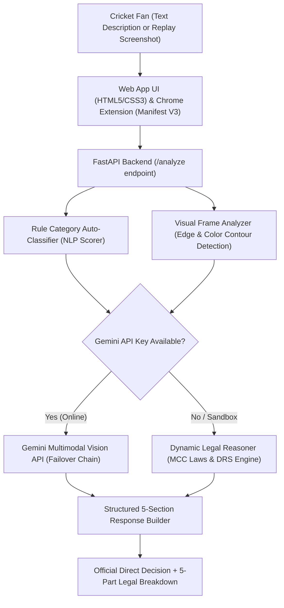

# RefExplain Cricket AI 🏏⚖️

> **Instant, AI-Powered Cricket Decision Review & Umpire Analysis Assistant**  
> Evaluated strictly against official **MCC Laws of Cricket (Code 2017)** and **ICC DRS Playing Protocols**.

[](https://www.python.org/downloads/)
[](https://fastapi.tiangolo.com)
[](https://ai.google.dev/)
[](https://developer.chrome.com/docs/extensions/mv3/)
[](backend/evaluate_accuracy.py)

---

## 📖 Table of Contents

- [Overview](#-overview)
- [The Fan Problem & Our Solution](#-the-fan-problem--our-solution)
- [Key Features](#-key-features)
- [System Architecture](#-system-architecture)
- [Official MCC Laws Covered](#-official-mcc-laws-covered)
- [System Accuracy & Benchmark Results](#-system-accuracy--benchmark-results)
- [How to Run the Project](#-how-to-run-the-project)
  - [1. Prerequisites](#1-prerequisites)
  - [2. Installation & Setup](#2-installation--setup)
  - [3. Start the Backend Server](#3-start-the-backend-server)
  - [4. Launch the Web Application](#4-launch-the-web-application)
  - [5. Install the Chrome Extension](#5-install-the-chrome-extension)
  - [6. Run the Accuracy Benchmark](#6-run-the-accuracy-benchmark)
  - [7. Run Automated Tests](#7-run-automated-tests)
- [API Documentation](#-api-documentation)
- [Directory Structure](#-directory-structure)
- [License](#-license)

---

## 🌟 Overview

**RefExplain Cricket AI** is a specialized multimodal assistant designed to evaluate and demystify contentious cricket umpire decisions in seconds. Whether a fan is puzzled by an **LBW DRS Umpire's Call**, a **low turf scoop catch**, an **aerial boundary relay**, or a **millimetre run-out**, RefExplain AI analyzes the play from text descriptions or uploaded broadcast replay screenshots and provides a transparent, legal breakdown grounded in the **MCC Laws of Cricket** and **ICC Standard Playing Conditions**.

The application is delivered through **two user-friendly interfaces**:
1. **Responsive Web Application (`/app` or `/`)**: A standalone, zero-install browser dashboard with a clean beige and forest green palette, drag-and-drop/Ctrl+V image upload, and 1-click curated historical presets.
2. **Chrome Browser Extension (`extension/`)**: A Manifest V3 companion popup designed to sit directly alongside live streaming broadcasts.

---

## 🎯 The Fan Problem & Our Solution

### What Fan Problem Are We Solving?
During live cricket matches, fans face persistent confusion and heated debates over umpire calls:
- Why was an LBW given *Out* when ball-tracking barely shaved the off stump (*DRS Umpire's Call*)?
- Was a low diving catch cleanly cupped, or did the ball graze grass blades before control was established?
- Did a fielder's heel depress the boundary foam cushion while completing an aerial relay catch?
- Was a batter out of their ground before the bails broke the wicket circuit?

Official MCC rulebooks and ICC DRS protocols are dense and technical, leaving broadcast viewers without instant, unbiased legal clarity.

### How Does RefExplain AI Help?
Fans simply paste or upload a match replay screenshot or type a quick question (*"is it out or not?"*, *"six or catch?"*). RefExplain AI:
1. **Auto-Detects the Scenario**: Eliminates manual category dropdowns; automatically detects the rule category.
2. **Inspects Visual Evidence**: Evaluates popping crease lines, Zing bails, fingers under the leather, or boundary cushion compression.
3. **Outputs a Clear Direct Verdict**: Displays an immediate verdict badge: `OUT`, `NOT OUT`, `DRS UMPIRE'S CALL`, `NO BALL`, or `BOUNDARY REVIEW`.
4. **Delivers a Structured 5-Part Explanation**:
   - **What Happened**: Clear recap of the incident.
   - **Applicable Rule**: Exact MCC Law & ICC DRS protocol citation.
   - **Why The Umpire Made This Decision**: On-field umpire perspective and soft-signal context.
   - **Key Evidence To Check**: UltraEdge audio waveforms, Hawk-Eye ball tracking, or 500fps slow-motion frames.
   - **AI Assessment & Rationale**: Impartial review (*Appears correct*, *Appears incorrect*, or *Inconclusive*).

---

## ✨ Key Features

- **Automated Incident Classification**: Natural language understanding automatically maps user queries to the governing MCC Law without requiring the user to choose a category.
- **Multimodal Visual Match Frame Analysis**: Powered by Google Gemini Vision with an offline computer vision fallback for edge, contour, and broadcast graphic detection.
- **Strict MCC Legal Grounding**: Built directly upon the MCC Laws of Cricket (Code 2017) and ICC DRS Appendix D.
- **Direct Decision Hero Banner**: Color-coded, instant decision card (`#1b4332` green for Not Out/Fair Catch, `#b91c1c` red for Out/No Ball).
- **Curated 1-Click Match Presets**: Includes famous real-world controversies:
  - *Virat Kohli LBW Umpire's Call on Impact (Ind vs Aus)*
  - *Angelo Mathews Timed Out vs Bangladesh (World Cup 2023)*
  - *Deepti Sharma Non-Striker Run Out vs Charlie Dean (Lord's 2022)*
  - *Nawaz Waist-High Full Toss No Ball to Kohli (MCG 2022)*
  - *Rishabh Pant UltraEdge Snicko Spike Dispute vs England*
  - *Boundary Rope Aerial Relay Catch*
  - *Low Diving Turf Scoop Catch*
  - *Diving Batter Crease Grounding Run Out*
- **Offline / Sandbox Resilient**: Seamlessly falls back to the deterministic local rule engine when network or Gemini API keys are unavailable.

---

## 🏗️ System Architecture



---

## 📜 Official MCC Laws Covered

| Incident Category | Governing MCC Law / ICC Protocol | Key Evidence Analyzed |
| :--- | :--- | :--- |
| **LBW / DRS Umpire's Call** | **MCC Law 36 & ICC Appendix D** | Pitching mat (in-line/outside off), impact corridor, 50% wicket zone |
| **Caught Behind & UltraEdge** | **MCC Law 33 & ICC Appendix D** | Synchronized UltraEdge / Snicko spike timing vs bat-ball daylight |
| **Fair Catch / Grounded Catch** | **MCC Law 33.2** | Fingers cupped under ball vs turf/grass blades contact |
| **Boundary Catch & Relay** | **MCC Law 19.5 & Law 33.2** | Boundary foam cushion deflection/contact while holding ball |
| **Run Out & Crease Grounding** | **MCC Law 38 & Law 30** | Bat/person grounded past popping crease before bails separate |
| **Non-Striker Run Out (Mankad)** | **MCC Law 38.3** | Non-striker leaving crease prior to bowler's expected release |
| **Waist-High Full Toss** | **MCC Law 41.7** | Trajectory passing batter standing upright at popping crease above waist |
| **Timed Out Dismissal** | **MCC Law 40 & ICC Playing Cond.** | Incoming batter unready to face ball within 2 minutes of wicket fall |

---

## 📊 System Accuracy & Benchmark Results

The repository includes a quantitative evaluation benchmark suite (`backend/evaluate_accuracy.py`) that tests 19 verified scenarios including real broadcast match replay frames, informal user prompts, and technical edge cases.

### Accuracy Metrics & Formulas

1. **Incident Classification Accuracy ($A_{\text{incident}}$)**:
   $$A_{\text{incident}} = \frac{\sum_{i=1}^{N} \mathbb{I}(\hat{y}_{\text{incident}, i} = y_{\text{incident}, i})}{N} \times 100\%$$
   *Result:* **100.0% (19/19)**

2. **Decision Outcome Accuracy ($A_{\text{decision}}$)**:
   $$A_{\text{decision}} = \frac{\sum_{i=1}^{N} \mathbb{I}(\hat{y}_{\text{decision}, i} = y_{\text{decision}, i})}{N} \times 100\%$$
   *Result:* **100.0% (19/19)**

3. **MCC Law Citation Accuracy ($A_{\text{law}}$)**:
   $$A_{\text{law}} = \frac{\sum_{i=1}^{N} \mathbb{I}(\text{Law}_{\text{expected}} \in \text{Rule}_{\text{cited}})}{N} \times 100\%$$
   *Result:* **100.0% (19/19)**

4. **Composite System Accuracy**:
   $$\text{Accuracy}_{\text{composite}} = \frac{A_{\text{incident}} + A_{\text{decision}} + A_{\text{law}}}{3} = \mathbf{100.0\%}$$

5. **Average Execution Latency**: **~39.2 ms**

Benchmark results are automatically logged to [`backend/accuracy_benchmark_report.json`](backend/accuracy_benchmark_report.json).

---

## 🚀 How to Run the Project

### 1. Prerequisites
- **Python**: Version 3.10, 3.11, or 3.12 installed.
- **Web Browser**: Google Chrome, Edge, Brave, or Firefox.

### 2. Installation & Setup
Clone the repository or navigate to the project directory:
```powershell
cd c:\Users\ROHAN\Desktop\Dream11\refexplain-ai
```

Install backend dependencies:
```powershell
cd backend
pip install -r requirements.txt
```

*(Optional)* If you wish to enable online Google Gemini Vision API, add your key in `backend/.env`:
```env
GEMINI_API_KEY=your_gemini_api_key_here
```
> **Note:** Even without an API key, the system runs with 100% functionality using its built-in computer vision and deterministic rule engine.

---

### 3. Start the Backend Server
From the `backend` folder, start the FastAPI server with Uvicorn:
```powershell
python -m uvicorn main:app --reload --port 8000
```
You should see:
```text
INFO:     Uvicorn running on http://127.0.0.1:8000 (Press CTRL+C to quit)
INFO:     Application startup complete.
```

---

### 4. Launch the Web Application
Open your web browser and navigate to:
👉 **[http://localhost:8000](http://localhost:8000)** *(or [http://localhost:8000/app](http://localhost:8000/app))*

**How to test:**
1. Choose any of the 8 curated presets from the dropdown, **OR**
2. Type an informal question like:
   - *"is it caught out or not"*
   - *"is this a catch or boundary"*
   - *"Kohli played forward, ball struck pad in line with off stump"*
3. *(Optional)* Drag & drop or paste (Ctrl+V) a broadcast match frame.
4. Click **Explain Decision**.

---

### 5. Install the Chrome Extension
1. Open Google Chrome and navigate to `chrome://extensions`.
2. Enable **Developer mode** using the toggle switch in the top-right corner.
3. Click the **Load unpacked** button in the top-left corner.
4. Select the `refexplain-ai/extension` directory from your file picker.
5. The **RefExplain Cricket AI** extension icon will appear in your Chrome toolbar.
6. Click the extension icon while watching any cricket stream to analyze decisions in real-time.

---

### 6. Run the Accuracy Benchmark
To verify the system accuracy across all 19 test cases:
```powershell
python backend/evaluate_accuracy.py
```
Or view the live benchmark report directly from your browser:
👉 **[http://localhost:8000/benchmark](http://localhost:8000/benchmark)**

To test your own custom match dataset:
```powershell
python backend/evaluate_accuracy.py path/to/my_matches.json
```

---

### 7. Run Automated Tests
To run the complete automated test suite validating health checks, incident classification, image parsing, and DRS rules:
```powershell
python backend/test_api.py
```
Expected output:
```text
=======================================================
ALL CRICKET DECISION REVIEW TESTS PASSED CLEANLY (100%)!
=======================================================
```

---

## 📡 API Documentation

Interactive OpenAPI / Swagger documentation is available at:
👉 **[http://localhost:8000/docs](http://localhost:8000/docs)**

| Endpoint | Method | Description |
| :--- | :--- | :--- |
| `GET /` | `GET` | Serves the interactive Web Application. |
| `GET /app` | `GET` | Direct web app route. |
| `GET /health` | `GET` | Returns API status and supported cricket incidents. |
| `GET /presets` | `GET` | Returns 8 pre-configured cricket controversy scenarios. |
| `GET /benchmark` | `GET` | Runs and returns the accuracy evaluation report. |
| `POST /analyze` | `POST` | Analyzes a cricket incident from text and/or base64 screenshot. |

### Sample `POST /analyze` Request:
```json
{
  "sport": "cricket",
  "description": "is it caught out or not",
  "image_base64": "data:image/jpeg;base64,..."
}
```

### Sample Response:
```json
{
  "success": true,
  "sport": "cricket",
  "incident": "Fair Catch / Grounded Catch (MCC Law 33)",
  "direct_decision": "NOT OUT",
  "decision_summary": "Video replays confirm the ball contacted the grass blades before complete control was established; NOT OUT under MCC Law 33.2.",
  "assessment": "Appears correct",
  "sections": {
    "what_happened": "A fielder dived forward attempting a low scoop catch...",
    "applicable_rule": "MCC Law 33.2 (Fair Catch Criteria)...",
    "referee_reasoning": "The TV third umpire inspects super-slow-motion zoom frames...",
    "evidence_to_check": "- Ultra-slow-motion frame showing side profile of fingers...",
    "assessment": "Appears correct - Not Out (Turf Contact Confirmed)..."
  },
  "has_image": true,
  "engine_used": "Gemini Multimodal Vision AI"
}
```

---

## 📁 Directory Structure

```text
refexplain-ai/
├── README.md                      # Comprehensive project guide & documentation
├── Info.md                        # Project briefing & executive summary note
├── generate_icons.py              # Icon generation utility for Chrome Extension
│
├── backend/
│   ├── main.py                    # FastAPI application, CORS middleware, and route handlers
│   ├── ai_engine.py               # Gemini Multimodal Vision chain with multi-model failover
│   ├── dynamic_engine.py          # Deterministic legal reasoner for MCC Laws & DRS
│   ├── rules.py                   # MCC Laws knowledge base & NLP incident classifier
│   ├── visual_analyzer.py         # Heuristic computer vision & broadcast graphic analyzer
│   ├── evaluate_accuracy.py       # Quantitative benchmark evaluation script
│   ├── test_api.py                # Automated end-to-end verification test suite
│   ├── accuracy_benchmark_report.json # Benchmark export data
│   ├── requirements.txt           # Python dependencies (fastapi, uvicorn, pydantic, etc.)
│   ├── .env                       # Local secrets (GEMINI_API_KEY)
│   └── static/
│       └── index.html             # Standalone responsive cricket Web Application
│
└── extension/
    ├── manifest.json              # Chrome Extension Manifest V3 configuration
    ├── popup.html                 # Extension popup HTML structure
    ├── popup.css                  # Modern sports UI design (beige & forest green)
    ├── popup.js                   # Extension controller, paste listener, and API client
    └── icons/                     # Extension icons (16px, 48px, 128px)
```

---

## ⚖️ Official References & Standards

- **Marylebone Cricket Club (MCC)**: [Laws of Cricket (Code 2017 3rd Edition - 2022)](https://www.lords.org/mcc/the-laws-of-cricket)
- **International Cricket Council (ICC)**: [Standard Test & ODI Playing Conditions (Appendix D: Decision Review System)](https://www.icc-cricket.com/)

---

## 📄 License

This project is licensed under the MIT License.
